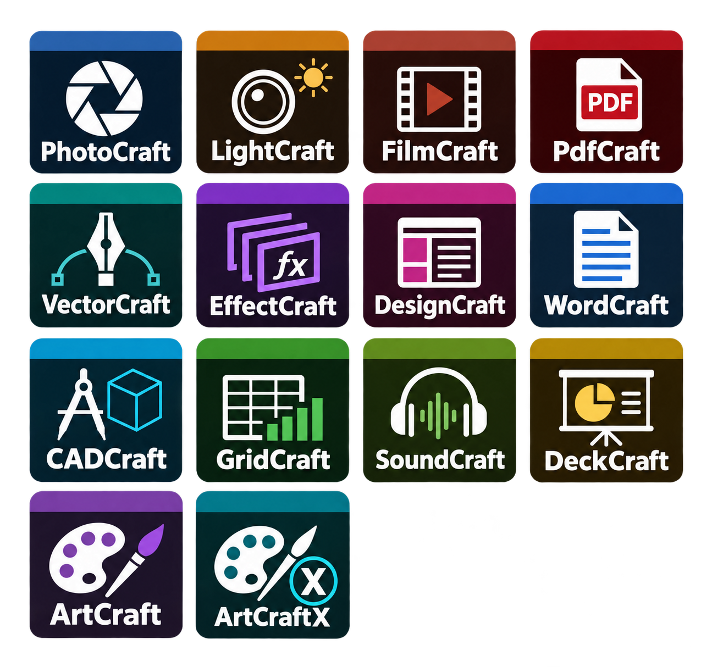

# Craft desktop icon suite



One approved generated sheet, split into 14 coordinated icons. Created with OpenAI's built-in imagegen tool for @timsamart on 2026-10-09. Exact prompt: `generation-prompt.txt`. The complete artwork and helpers are offered under MIT; see `LICENSE.txt`.

Each PNG is 512x512 RGBA with transparency. Each ICO contains 16, 24, 32, 48, 64, 128 and 256px frames. `manifest.json` records the source crop for every application. Names identify the corresponding projects; this is an independent customization.

To reproduce extraction, install Pillow and run `python split-icons.py` in this folder. The saved generated sheet is the reproducible input; a new generation may differ.

To apply the complete suite to an existing installation with portable launchers:

```powershell
powershell -ExecutionPolicy Bypass -File .\apply-icons.ps1 -InstalledRoot 'H:\repos\my-workspace\storytold\installed'
```

Adjust the installation directory as needed. The script copies ICOs into a permanent `icons` folder, updates existing Start and portable shortcuts, preserves executable targets, records a backup and verifies the resulting shortcuts. It does not change the icons embedded in executables or running application windows.

Validation performed: all 14 PNG dimensions and alpha channels, all seven sizes in every ICO, asset hashes, and all local Start/portable shortcut references and targets.
